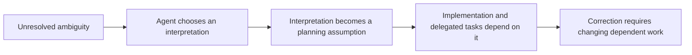
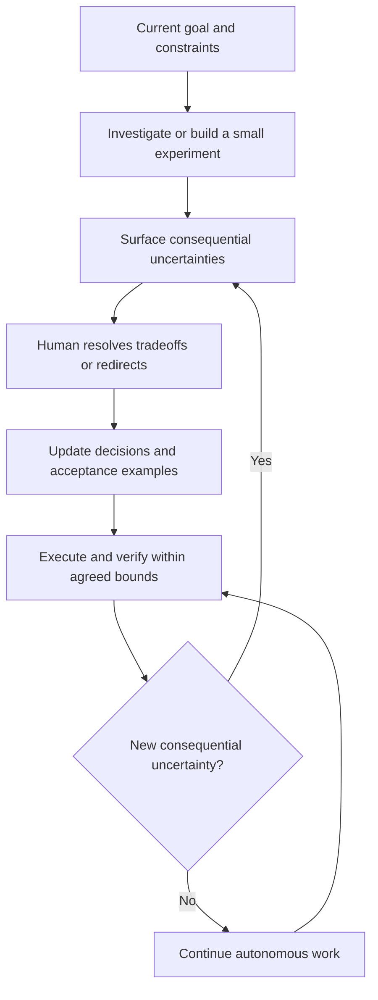

# Agentic agility conversation with Codex

Source: the parallel Codex chat, exported 2026-11-20. Substantive user and assistant messages are preserved below; routine progress updates, thinking, tool calls, and tool output are omitted. Markdown and transport whitespace are lightly normalized. This is a discussion record, not a finished article.

The separate Claude conversation is in conversation.md. Sources and the current collaboration brief are in codex-research.md.

## User original notes

There's something that I want to write a blog article about: we have approaches in agentic software development like spec-driven design, and in particular, the interpretation of that, that you should be building big specifications upfront and then one shot their implementation. I see this as flawed for the same reason as big PRDs in the past were flawed. Yes, we now have agents to maintain those documents for us, but in order to assess whether we are aligned, I still need to read them. And humans do a poor job of reading anything beyond 400 lines in one go (or so I hear).

There's also this idea that everything needs to be checked retroactively. That is not feasible if we really want to harness the power of Agentic software development.

Then there is this notion of what I call agentic leverage. It's the leverage you get by providing input tokens and the agent providing effective output tokens. By effective output tokens in this case I mean to exclude thinking tokens, the tool calls, and the starting of other agents in order to produce the effective result measured in tokens. In a way, we seek to maximize our agentic leverage, Producing minimal Instructions for the agent with maximum effect. What we see in practice is that errors compound. The more a single agent starts to follow a trajectory that's not aligned with your intention, the worse it gets. And through the telephone game, it will also instruct other agents to do things that are increasingly not aligned with your intention.

The proper middle ground is agentic agility:

- Provide enough instructions so that the agent can start working on a better definition of why something needs to happen, or what needs to happen, or how it should be done.
- Research gets condensed to just the pain points, the crucial/risky/costly decisions to be made, the ambiguities to resolve.
- The human provides enough input on each of these so that the agent can start a next iteration.
- The human and agent iteratively shape / constrain the solution space until one is carved out that matches the human intent regardless of further implementation details.

This allows me to use the Agentic leverage, while preventing error compounding from escalating / spiraling.

These are just my rough draft notes / thoughts. Before you write this down, let's see if we can provide some structure to these thoughts. And maybe also explore some visualizations of the ideas. Do some digging into research and blog articles that go over the same topics that I should be referencing. And critically assess my thoughts on the basis of that.

## Codex initial assessment

I think the strongest version of your argument is:

> **Agents make producing specifications and implementations cheaper. They do not automatically make establishing shared understanding cheaper. Agentic agility uses human attention to resolve consequential uncertainty before agents build too much on it.**

That gives the article a clear center. It also connects your three ideas: **leverage creates the opportunity, compounding misunderstanding creates the risk, and iterative alignment manages the tradeoff.**

I would sharpen the argument in several places before drafting.

**1. Target a particular interpretation of spec-driven development.**

Your criticism is strongest when aimed at *large commitments made before enough learning has happened*: generate an extensive specification, approve it as a whole, then delegate a large implementation.

Spec-driven development does not inherently require that workflow. GitHub’s introduction to Spec Kit explicitly describes human checkpoints for critiquing and refining the specification and plan. You should acknowledge that so readers cannot dismiss the argument as attacking a caricature. Your question then becomes: **Are those checkpoints designed around decisions a human can meaningfully assess?** [GitHub’s introduction](https://github.blog/ai-and-ml/generative-ai/spec-driven-development-with-ai-get-started-with-a-new-open-source-toolkit/)

Birgitta Böckeler’s **“Understanding Spec-Driven-Development: Kiro, spec-kit, and Tessl”** is probably your closest reference. Her practical evaluation describes verbose, repetitive Markdown artifacts, disproportionate review effort, and a possible false sense of control. She distinguishes several meanings of SDD, which would help you state precisely which practice you are criticizing. This is practitioner evidence, rather than a controlled comparison. [Böckeler, October 2025](https://martinfowler.com/articles/exploring-gen-ai/sdd-3-tools.html)

Your own contribution could be expressed as:

> **A specification’s usefulness depends partly on how effectively people can challenge its consequential decisions.**

A long reference document can remain useful. The problem arises when reading and approving that whole document becomes the mechanism for establishing alignment.

**2. Drop the general “400 lines” claim.**

There is a recognizable source behind it: SmartBear’s guidance, drawing on its Cisco study, recommends reviewing fewer than 200–400 **lines of code** at a time and limiting review sessions. That does not establish a general human limit for reading specifications or prose. [SmartBear’s account](https://smartbear.com/learn/code-review/what-is-code-review/)

You do not need a numerical threshold. The defensible point is:

> **Automating document maintenance does not eliminate the human effort required to understand, question, and accept its contents.**

Length is only one factor. A short document can conceal a major assumption; a long document can make an important tradeoff easy to find.

**3. Keep “agentic leverage,” but separate amplification from value.**

Your proposed ratio captures something recognizable:

\[
\text{Token leverage} =
\frac{\text{tokens in the resulting deliverable}}
{\text{human-authored instruction tokens}}
\]

That follows your exclusion of reasoning, tool calls, and delegation overhead from the resulting deliverable. It describes how much an agent produces from your contribution.

It becomes misleading as an optimization target, though:

- A verbose implementation scores better than a concise one.
- Removing unnecessary code may deliver substantial value while producing little.
- A terse prompt can generate hours of reading and correction.
- Repository instructions and established conventions supply context beyond the immediate prompt.

I would preserve the ratio as an illustration of **amplification**, then make your practical objective:

> **Increase useful, accepted progress per unit of human attention, while accounting for compute cost and failure risk.**

Human attention includes explaining, answering questions, reading plans, reviewing results, and correcting mistakes. A slightly longer instruction can improve overall leverage if it removes a costly ambiguity.

Anthropic’s context-engineering guidance is relevant here: it advocates selecting a small amount of highly informative context to improve outcomes. That supports *information density*, rather than brevity for its own sake. [Effective context engineering](https://www.anthropic.com/research/effective-context-engineering-for-ai-agents)

**4. Your concern about compounding errors has support, but needs a precise mechanism.**

I would describe the mechanism this way:

The multiplication is in the **work dependent on the assumption**. You do not need to claim that every extra step makes error probability grow exponentially.

The research offers useful support:

- **“Why Do Multi-Agent LLM Systems Fail?”** analyzes more than 1,600 traces across seven frameworks. Its taxonomy includes system-design issues, inter-agent misalignment, and verification failures. This supports your concern that delegation introduces failure mechanisms beyond whether an individual model can solve a task. It does not establish that delegation always worsens alignment. [Cemri et al., revised October 2025](https://arxiv.org/abs/2503.13657)
- **“Towards a Science of Scaling Agent Systems”** finds that coordination benefits depend strongly on the task and architecture. Parallelizable work can benefit; sequential dependencies and coordination overhead can undermine performance. Its experiments also show that coordination structure affects error amplification. These are benchmark findings, rather than a universal law for software teams. [Google Research, January 2026](https://research.google/blog/towards-a-science-of-scaling-agent-systems-when-and-why-agent-systems-work/)

The “telephone game” is a useful metaphor, but there are two distinct problems: instructions can become distorted during handoffs, and agents can faithfully propagate an interpretation that was wrong from the beginning.

Your approach should address both. Delegated work should retain access to the agreed intent, constraints, and unresolved questions—not depend exclusively on successive paraphrases.

**5. Iteration itself does not guarantee alignment.**

This is the most important challenge I found to your proposed solution.

**“LLMs Get Lost in Multi-Turn Conversation”** reports worse performance when task requirements are distributed across multiple conversational turns. The authors identify premature assumptions and excessive reliance on earlier answers as contributors. [Laban et al., 2025](https://arxiv.org/abs/2505.06120)

That challenges any simple claim that “more conversation produces better alignment.” However, the study uses simulated conversations with distributed requirements; it does not directly test your proposed collaboration process.

The implication for your method is that iterations need an explicit way to **revise the current understanding**:

- Distinguish agreed decisions from working assumptions.
- Identify which earlier decisions new evidence invalidates.
- Consolidate the current intent and constraints.
- Start execution from that updated account, using fresh context when accumulated history becomes misleading.

The authors themselves recommend consolidating requirements before retrying a conversation that has gone off course. Treat this as a mitigation, not a guarantee. [The paper’s practical recommendations](https://arxiv.org/html/2505.06120v1#S7.SS4)

This makes “agentic agility” more specific than an ongoing chat: it is a process for producing **revisable commitments grounded in evidence**.

**6. Revise the claim about retrospective checking.**

“Everything must be checked retroactively” bundles together different activities:

| Activity | What it establishes |
|---|---|
| Clarifying goals and tradeoffs | Whether the proposed direction reflects human intent |
| Tests, analysis, and technical review | Evidence that the implementation behaves correctly |
| Trying the product in context | Whether it actually addresses the need |

Early alignment can reduce avoidable work. It cannot establish the correctness of code that has not yet been written, or prove that users will find the result useful.

I would frame your objection as:

> **A workflow that requires humans to reconstruct every important decision from a large finished artifact limits the leverage agents can provide.**

The alternative is to make consequential decisions visible earlier and gather verification evidence throughout execution. Some changes will still warrant substantial human code review.

There is also a credible counterpoint to making human checkpoints too frequent. Anthropic describes multi-hour application-building runs using planners, generators, evaluators, and structured handoffs. This is a vendor engineering report, not proof of general reliability, but it demonstrates why your method should permit long autonomous stretches when the work is sufficiently constrained and evaluable. [Harness design for long-running applications, March 2026](https://www.anthropic.com/research/harness-design-long-running-apps)

**Your proposed middle ground becomes stronger with a stopping rule.**

I would define it provisionally as:

> **Agentic agility is a way of working in which humans and agents progressively clarify intent, test consequential assumptions, and expand autonomous execution as uncertainty becomes manageable.**

The practical loop could look like this:

Crucially, the next iteration might produce a prototype, a failing test, a user observation, or an implementation slice. Otherwise, the method risks recreating a lengthy specification phase through many small conversations.

For each human-facing decision, the agent could present:

- **Decision:** what needs resolving.
- **Consequence:** why choosing incorrectly matters.
- **Alternatives:** materially different options and tradeoffs.
- **Recommendation:** supported by evidence, with uncertainty visible.
- **Boundary:** what work can proceed after this decision.

Compression needs care: a summary should preserve meaningful alternatives and contrary evidence, with links to the underlying material. Otherwise, the agent can make its preferred answer seem inevitable.

A useful proposed rule is: **request human input when resolving an uncertainty is likely to prevent more consequential rework than the interruption costs.** This is a design heuristic, not an established empirical formula. It suggests frequent interaction around unclear goals and costly commitments, and substantial autonomy around well-understood, reversible work.

I would also soften your final destination. You rarely need to carve out one solution whose remaining details cannot affect intent. You need a set of acceptable solutions, examples of acceptable behavior, and clear reasons to reopen a decision. Human intent may itself change through seeing prototypes.

**For the article, I would use this sequence:**

1. **The apparent shortcut:** agents can generate extensive plans and implementations from little human input.
2. **The remaining cost:** people still have to establish what they are agreeing to.
3. **The failure mechanism:** unresolved interpretations acquire dependent work.
4. **Agentic agility:** use research and experiments to surface consequential decisions, then update the shared understanding.
5. **Conditional autonomy:** let agents proceed broadly where choices are bounded and verification is effective.
6. **An honest limitation:** the approach is a reasoned proposal supported by related findings; its overall advantage still needs testing.

Two additional references would help position it:

- **Barry Boehm’s spiral model** is an especially relevant predecessor: development organized around identifying and resolving risks. Acknowledging it gives the article historical depth. [Boehm, 1988](https://ieeexplore.ieee.org/document/59)
- **Addy Osmani’s “How to write a good spec for AI agents”** already advocates concise initial direction, modular context, boundaries, and continuous iteration. Your distinctive emphasis can be the design of human attention and decision review. [Osmani, January 2026](https://addyosmani.com/blog/good-spec/)

The phrase *agentic agility* also has existing usage, including Martin Hinshelwood’s writing, so I would introduce this as your specific definition rather than claim to coin the term. [Existing usage](https://nkdagility.com/resources/newsletters/)

For visuals, the **dependency chain** above best explains the problem, while the **feedback loop** explains the method. A third promising illustration would show several acceptable solution paths remaining after each human decision. That would convey progressive constraint without implying that every implementation detail must be decided upfront. I would avoid a numerical “optimal leverage” curve unless clearly labeled as a hypothetical model.

To strengthen the eventual article, one worked example would do more than another abstract claim: show an ambiguous request, the few decisions surfaced, the human’s answers, and which implementation work those answers changed. A later comparison could measure total human attention, accepted functionality, rework, defects, and compute cost across workflows.

A working title that captures the argument: **“Agentic Agility: Put Human Attention Where It Changes the Outcome.”**

## User clarification about checking and learning

I see also that I forgot to fill in that section on retro-active checking. What I meant to say is that much of the checking ought to be up-front, rather than in detail after the fact. And that we can use agents also to help us in the same kind of loop afterwards. Taking the large outputs and reduce them so that our human attention can cope, providing instructions that do the corrections. Agents can help us identify the risky areas so that we can scale our attention proportional to risk. And risks can come from both the established solution and the change.

Another note to add: We also see that learning suffers when employing agents. There is no substitute for humans to time, attention, deeply engaging with a problem. Not doing that unfortunately means having limited understanding of the problem. Again, trying to understand everything (reading every line of code) means foregoing agentic leverage. What we need instead is to understand the major structures of the problem and solution space. We can go more fuzzy on the details, of which there are many. Ideally, we leverage the pareto 20/80 principle. Understand enough of the 20% top-level structure that the 80% blank area can be somewhat safely speculated about.

## Codex revised assessment

That changes the argument in a useful way. You are proposing **a continuous process for directing human attention**: anticipate consequential mistakes, use agents to examine what was produced, and deepen human understanding where it matters most.

I would now organize the ideas around three connected problems:

| Problem | What agentic agility contributes |
|---|---|
| Misunderstanding grows into dependent work | Resolve consequential ambiguities before making large commitments |
| Output grows faster than human review capacity | Use agents to expose risks, evidence, and decisions that warrant attention |
| Delegation removes opportunities to learn | Deliberately build enough understanding to steer and challenge the work |

The learning point is especially important: **the ability to direct attention toward risk depends on having enough understanding to recognize risk.**

**1. Checking becomes a loop before and after implementation.**

Your clarification resolves my earlier concern. Upfront checking establishes the intended behavior, constraints, architectural choices, and acceptance examples. Afterwards, agents help assess what actually happened and present a manageable account for human judgment.

Both sides can follow the same pattern:

> Investigate broadly → surface consequential uncertainties → human examines and directs → agent acts → gather evidence → repeat.

The human-facing output should do more than summarize. It should expose:

- Which assumptions matter most.
- What evidence supports or challenges them.
- Where the result differs from the agreed direction.
- What remains uncertain.
- Which details warrant direct inspection.

That preserves your leverage: humans can issue a small number of consequential corrections after substantial agent work.

However, a reassuring summary is not evidence of correctness. Claims should remain traceable to code, tests, observed behavior, or other underlying material. The agent’s assessment should make deeper inspection easier.

**2. Risk belongs to the system, the change, and their interaction.**

Your observation about the established solution is essential. Reviewing only the changed lines can miss the conditions that make those lines consequential.

For example, a small caching change might interact with an existing authorization model and expose one user’s data to another. Understanding cache syntax is less important here than understanding identity, cache keys, and the boundary between users.

I would therefore describe review scope as **the change plus the assumptions and dependencies it affects**.

There is relevant empirical support for helping reviewers locate risk. A controlled experiment with 48 participants found that a tool presenting historical risk information improved risk awareness and defect detection. It did not establish a statistically significant improvement in review speed. That supports your direction, while leaving open how reliably agents can perform this assessment. [Yu et al., 2024](https://rebels.cs.uwaterloo.ca/papers/emse2024_yu.pdf)

I would soften “attention proportional to risk” slightly. It is a useful principle, but risk estimates are uncertain. High potential harm, weak evidence, unfamiliar behavior, and difficult recovery should all increase scrutiny. Some sampling outside the flagged areas also helps detect weaknesses in the risk assessment itself.

**3. The learning concern has direct support—but depends on how agents are used.**

A closely relevant reference is **“How AI Impacts Skill Formation.”** In Anthropic’s randomized study of 52 mostly junior engineers learning an unfamiliar Python library, the AI-assisted group averaged 50% on the subsequent assessment, compared with 67% for the unassisted group. Debugging showed the largest gap; average task-time improvement was not statistically significant. This measures immediate learning in a bounded task, rather than long-term loss of expertise. [Study report, January 2026](https://www.anthropic.com/research/AI-assistance-coding-skills)

Crucially, the researchers also observed interaction patterns involving conceptual inquiry and active comprehension that preserved learning. Those patterns were observed within the experiment, rather than randomly assigned, so they suggest promising practices without proving which practice caused better learning. [Shen and Tamkin](https://arxiv.org/abs/2601.20245)

I would consequently formulate your claim as:

> **Delegating the work can also delegate the cognitive activity through which we would have learned. Preserving that learning requires deliberate engagement.**

Time matters because engagement takes time. Time alone is insufficient: passively reading an agent’s explanation can also leave someone with a fragile understanding.

A practical addition to your loop is to ask the human to **predict or explain something**, then use the agent to test that understanding. For example:

- Predict how a failure propagates through the system.
- Explain why one architectural alternative was rejected.
- Identify which assumption makes an optimization safe.
- Walk through one representative execution path.

These activities reveal whether the person has acquired a usable model.

**4. Keep Pareto as an intuition, without relying on a literal 20/80 split.**

Your underlying idea is sound: people already work effectively with selective understanding and abstractions. Agentic development makes choosing that understanding more consequential.

But “the top-level 20%” is not necessarily where the crucial knowledge sits. A subtle detail about transaction isolation, cancellation, or authorization may determine whether the whole design works.

I would describe the goal as **selective depth**:

| Understand well enough to reason about | Often delegate within established boundaries |
|---|---|
| Goals, constraints, and unacceptable outcomes | Repetitive implementation |
| Major components and their contracts | Routine internal mechanics |
| State ownership, dependencies, and trust boundaries | Details covered by credible checks |
| Important failure modes and recovery paths | Work that is inexpensive to inspect or reverse |
| Where your own understanding stops | Details that can be investigated when needed |

The useful distinction is between details whose correctness you can reasonably establish through contracts and evidence, and details whose significance you do not yet understand.

I would replace “safely speculate about the blank area” with **“reason about the details conditionally, knowing which assumptions support that reasoning.”** That retains uncertainty without treating plausibility as assurance.

These additions also suggest a stronger visualization: an **attention map** of the system. Show established components, overlay the change and its affected dependencies, then mark where uncertainty or consequences justify deeper human engagement. Leave other regions at lower detail. That would express your idea more accurately than a funnel that steadily eliminates all uncertainty.

The article’s working thesis could now be:

> **Agentic agility combines broad delegation with selective human depth. Agents help expose consequential decisions and assess results; humans invest attention in the structures, assumptions, and risks needed to direct the work—and preserve their ability to keep directing it.**

That gives learning a central role in the argument. It sustains the judgment on which future agentic leverage depends.

## User request to save the material

I've started a blog article research document under Agentic Agility. Can you also dump your conversation and materials there?

The user subsequently supplied the destination:

/Users/merlijn/Documents/local-projects/watane/blog/agentic-agility/

## User collaboration instruction

Expect a call from Claude for you to collaborate on writing the document

