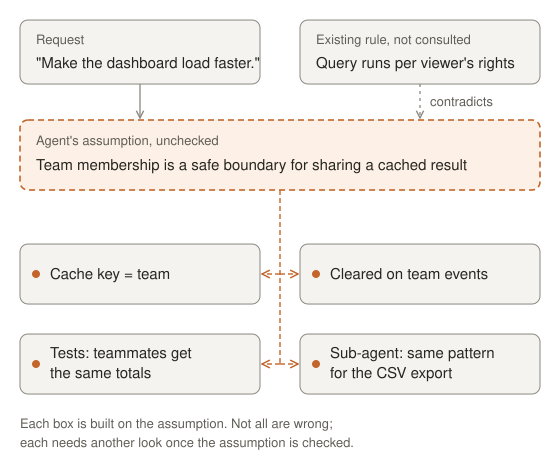

<!-- Section 2. Author: Claude. Target 240 words. Covers C3. Figure 1: figures/fig1-dependents.svg -->

## A wrong assumption gathers dependents

An open question gets expensive when the agent commits to an answer without
checking it. Investigating, running a throwaway experiment, or keeping the
existing rule would all have counted as progress too. Here the agent committed:
the team is the sharing boundary. That premise then gathers dependents. The cache
key is the team. The cache is cleared when the team's data changes. The tests
check that two teammates get the same cached totals. A sub-agent asked to "speed
up the CSV export the same way" copies the pattern. Each step is consistent with
the premise, and each depends on it.

When someone finally checks the premise against the permission rules, all four
need another look. Not all of them will be wrong; the invalidation logic may
survive. But each was built on the premise, so each has to be checked again, and
the more work that rests on it, the more there is to check.

Delegation can widen the circle in two ways. A handoff can lose a decision:
Cognition's [case against multi-agent setups](https://cognition.com/blog/dont-build-multi-agents)
is that every action carries implicit decisions that a sub-agent working from
partial context cannot see. A study of more than 1,600 multi-agent traces lists
misalignment between agents as one of its three main failure classes
([Cemri et al.](https://arxiv.org/abs/2503.13657)). Or the handoff passes the
premise on faithfully, wrong as it was. None of this argues against delegation; on
work that splits into independent parts, more agents can help
([Kim et al.](https://arxiv.org/abs/2512.08296)). The trouble is an unchecked
premise that many parts share. Tests written from that premise pass. A test
written from the permission rules would have failed.
