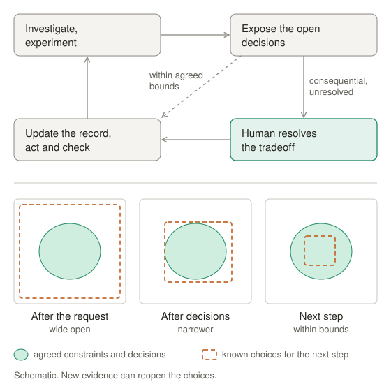

<!-- Section 4. Author: Claude. Target 470 words. Covers C4. Figure 2: figures/fig2-loop.svg. The watane paragraph is marked [IF THE USER AGREES]. -->

## Make the next decision visible

The alternative to a big plan is not no plan. It is a loop that brings decisions
to the surface a few at a time.

I start with enough direction for the agent to investigate: why something needs
to happen, what should happen, or how, whichever I know. The agent reads the
code, runs a quick experiment if one is cheap, and comes back with no plan yet.
It brings what it found, and the few decisions that would change the work. For
the dashboard, with invented findings:

> **Found:** the dashboard query applies each viewer's permissions. Any speed-up
> keeps that rule; it is not up for decision.
> **Decision:** how fresh must the numbers be, and is a cache worth its
> complexity?
> **Why it matters:** the numbers are live today. A cache trades freshness for
> speed, including just after someone's access changes.
> **Options:** (a) cache per viewer, with a short lifetime; (b) share a result
> between viewers whose permitted data is identical, and recheck access on every
> hit; (c) no cache: the slow part looks like one join, which may be fixable.
> **Recommendation:** try (c) as a throwaway experiment and measure. Choose
> between (a) and (b) only if (c) falls short.
> **Unblocks:** the experiment now, the cache design later.

I answer: at most a minute old, permission changes show at once, try (c) first.
Answering may take thought, and I may want to read the query first. But I am
answering the premise the work will rest on, not approving a document in which
that premise is one line among hundreds. When the question is whether we agree
on intent, the unit of review is a decision, not a document. A document can still
hold the decisions; what I approve is the decisions.

The answers go into a short record of what is agreed, what is assumed and what
is still open. The record exists because long conversations drift: models tend
to hold on to early assumptions after the conversation has moved past them
([Laban et al.](https://arxiv.org/abs/2505.06120)). So superseded decisions are
struck out, and when the history starts to mislead, the next step starts fresh
from the record. That is my proposed guard against the drift, not a proven one.
A record can drop an assumption too, so I read it as well.

When do I stop deciding and let the agent run? When the remaining choices fall
within what we agreed, the consequential questions are answered or contained,
and there is a credible way to check the result. Then the agent takes the next
bounded step, and the questions reopen when one of those conditions changes. The
experiment with (c) is such a step: a big question is still open, but contained.

[IF THE USER AGREES] In my own project, every task brief an implementing agent
receives carries the rule: "If THE TASK needs a decision that the specs do not
make and that is costly to undo (a wire format, a public interface of another
subsystem, a security boundary), do not guess: stop and say so."

None of this is new. [Boehm's spiral model](https://ieeexplore.ieee.org/document/59)
organised projects around resolving the riskiest unknowns first, and DORA counts
working in [small batches](https://dora.dev/capabilities/working-in-small-batches/)
among the capabilities that turn AI-assisted speed into better outcomes. What
agents add is help with the investigating, prototyping and gathering of evidence,
which makes working through decisions this way practical on ordinary tasks.
