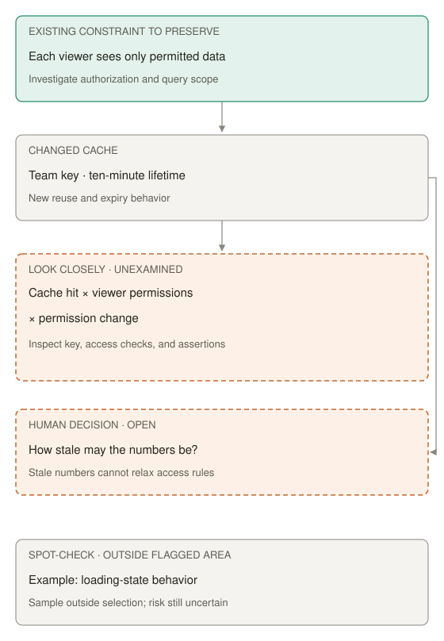

## Review the changed and affected system

The same loop applies once there is something to inspect: investigate, expose consequential questions, judge, then act and check. Before implementation, the evidence came from research and experiments. Afterwards, it includes observed behavior, diffs, and tests.

I want pointers to evidence I can examine: the relevant code, the assertion or observation, and why it addresses the risk. A summary saying that permissions are respected gives me little to assess.

Return to the dashboard's team cache with its ten-minute lifetime. Does a cache hit still respect the viewer's permissions? What happens when a manager moves to an engineering role? The existing visibility rules constrain those answers. Accepting older numbers would not, by itself, authorize showing data the viewer is no longer permitted to see.

Freshness needs its own check. The agent should expose the product decision about tolerated staleness, then demonstrate that reuse and expiry follow it. The two questions need different evidence.

Risk comes from the established system, the change, and their interaction. The new cache may be a small diff. The authorization path it affects may be unchanged. Both belong in the review.

*Green marks an established constraint; orange marks questions needing examination. Neither is a correctness score.*

A test showing two requests return the same result might encode the mistaken sharing assumption. A useful check distinguishes viewers with different permissions and verifies the required visibility behavior. I need to see what is asserted and why.

[Yu and colleagues' controlled experiment](https://rebels.cs.uwaterloo.ca/papers/emse2024_yu.pdf) found that historical risk analytics improved reviewers' risk awareness and defect detection, without a statistically significant speed improvement. That supports making risk visible; it does not validate an agent's ranking.

I would challenge that ranking using coverage information, static-analysis findings, and traced dependencies, then inspect some areas outside its selection. These signals have limits: coverage alone cannot establish that an assertion tests the required behavior.

Corrections then become instructions: repair the implementation, strengthen a check, invalidate an assumption, or reopen a product decision. Revising the requirement merely to fit the implementation would hide the disagreement.

That judgment requires some understanding of the system. Receiving the agent's map does not give me the mental model needed to question it.
