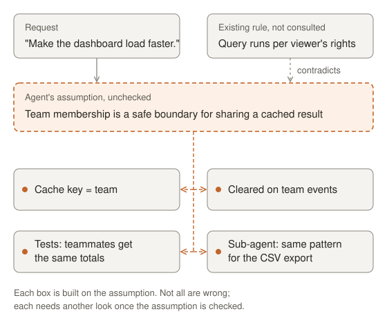
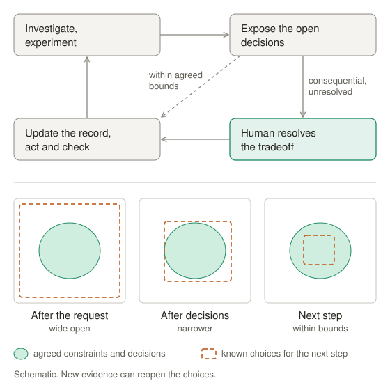
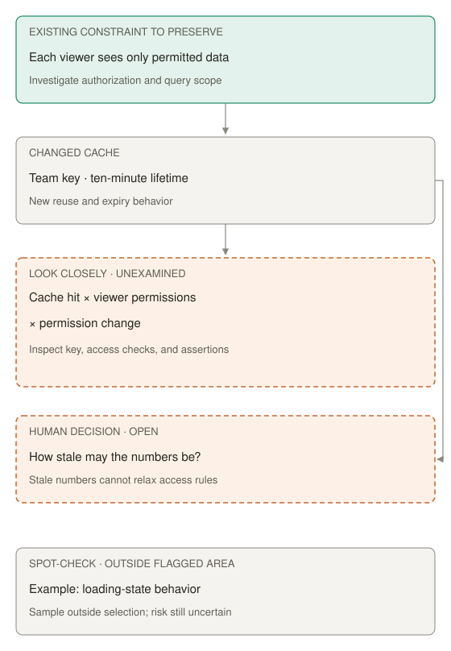

# Agentic agility

*Agents can build faster than we can understand. Keep commitments small where the assumptions are unresolved.*

"Make the dashboard load faster."

That is the whole request. An agent finds the slow aggregate query and caches
its result per team for ten minutes. The tests pass, the page is quick, and
nothing in the request was ignored. *(This is an illustration, not a real
incident.)*

Two decisions came with that cache, and nobody made either of them on purpose.

The first had already been made. The old query ran once per viewer, with that
viewer's permissions: a manager saw the salary column, an engineer on the same
team did not. Sharing one result per team assumes that team membership is a safe
boundary for sharing. The code said otherwise, and the agent did not look.

The second had never been made. The numbers used to be live; now they can be ten
minutes old, even right after someone's access changes. Whether that is
acceptable is a product question, and nobody asked it.

One is a constraint the agent should have found, the other a question it should
have asked. Both get expensive the same way: through everything built on them
before anyone looks.

## Producing the spec does not establish agreement

I see a familiar temptation in agentic development: write a large specification, let the agent implement it, then discover how much agreement the document actually contained. It resembles the old problem with large product requirements documents. Agents can maintain the text for me, but I still have to understand what I am accepting.

That criticism needs a precise target. Spec-driven development includes workflows with feedback and small implementation tasks. [GitHub's introduction to Spec Kit](https://github.blog/ai-and-ml/generative-ai/spec-driven-development-with-ai-get-started-with-a-new-open-source-toolkit/) explicitly includes checkpoints for reflection and refinement. A specification can preserve decisions reached through that process.

In her [evaluation of Kiro, Spec Kit, and Tessl](https://martinfowler.com/articles/exploring-gen-ai/sdd-3-tools.html), Birgitta Böckeler found verbose, repetitive documents, substantial review overhead, and occasions when elaborate instructions gave a false sense of control.

As agents produce more, my ability to assess their work can become the limiting resource.

The dashboard request was short. A long specification could have hidden the same assumption about sharing, or quietly introduced the same ten-minute lifetime. Keeping the document current would not tell me whether I had examined either choice.

| What I hand over | What I still need to judge |
| --- | --- |
| A detailed specification | Which consequential choices have actually been settled? |
| A short request | Which constraints must the agent find, and which choices remain open? |

The size of the artifact tells me little about the size of the commitment. A long reference may preserve many decisions already reviewed. A short instruction may launch substantial work on an unresolved question.

The expensive mistake is letting that work accumulate before examining the question.

## A wrong assumption gathers dependents

An open question gets expensive when the agent commits to an answer without
checking it. Investigating, running a throwaway experiment, or keeping the
existing rule would all have counted as progress too. Here the agent committed:
the team is the sharing boundary. That premise then gathers dependents. The cache
key is the team. The cache is cleared when the team's data changes. The tests
check that two teammates get the same cached totals. A sub-agent asked to "speed
up the CSV export the same way" copies the pattern. Each step is consistent with
the premise, and each depends on it.

When someone finally checks the premise against the permission rules, all four
need another look. Not all of them will be wrong; the invalidation logic may
survive. But each was built on the premise, so each has to be checked again, and
the more work that rests on it, the more there is to check.

Delegation can widen the circle in two ways. A handoff can lose a decision:
Cognition's [case against multi-agent setups](https://cognition.com/blog/dont-build-multi-agents)
is that every action carries implicit decisions that a sub-agent working from
partial context cannot see. A study of more than 1,600 multi-agent traces lists
misalignment between agents as one of its three main failure classes
([Cemri et al.](https://arxiv.org/abs/2503.13657)). Or the handoff passes the
premise on faithfully, wrong as it was. None of this argues against delegation; on
work that splits into independent parts, more agents can help
([Kim et al.](https://arxiv.org/abs/2512.08296)). The trouble is an unchecked
premise that many parts share. Tests written from that premise pass. A test
written from the permission rules would have failed.

## Count all the human attention

My first definition of *agentic leverage* was a token ratio: effective output tokens divided by the human input tokens that prompted them. Effective output meant the deliverable, excluding reasoning, tool calls, and the instructions used to start other agents.

That captures the appeal. A small contribution from me can produce a substantial result. But the ratio rewards verbosity. Removing unnecessary code might be valuable while producing almost no output. A short prompt can also leave me with hours of reading and correction.

I would keep that ratio as *token leverage*: a measure of amplification.

**Agentic leverage is the useful, accepted work I get per unit of my attention: explaining, answering, reading, reviewing, and correcting.**

| Token leverage accounts for | The human attention account also includes |
| --- | --- |
| Instructions I provide | Explaining context and resolving questions |
| Deliverable tokens produced | Reading plans, inspecting evidence, and judging results |
| Output relative to input | Correcting mistakes and reconsidering dependent work |

Quality, compute cost, and risk still matter; this is a way to evaluate a workflow, rather than a universal productivity score.

In [METR's early-2025 trial](https://metr.org/blog/2025-07-10-early-2025-ai-experienced-os-dev-study/), developers took 19% longer with AI but believed it had made them 20% faster; those historical results concern that setting, while [METR's 2026 follow-up](https://metr.org/blog/2026-02-24-uplift-update/) reports selection and measurement problems that complicate later estimates.

Felt speed is insufficient. For the dashboard, investigating the visibility constraint and asking how stale the numbers may be could save later review and correction. That input costs attention too. The useful comparison includes both its cost and the dependent work it changes.

## Make the next decision visible

The alternative to a big plan is not no plan. It is a loop that brings decisions
to the surface a few at a time.

I start with enough direction for the agent to investigate: why something needs
to happen, what should happen, or how, whichever I know. The agent reads the
code, runs a quick experiment if one is cheap, and comes back with no plan yet.
It brings what it found, and the few decisions that would change the work. For
the dashboard, with invented findings:

> **Found:** the dashboard query applies each viewer's permissions. Any speed-up
> keeps that rule; it is not up for decision.
> **Decision:** how fresh must the numbers be, and is a cache worth its
> complexity?
> **Why it matters:** the numbers are live today. A cache trades freshness for
> speed, including just after someone's access changes.
> **Options:** (a) cache per viewer, with a short lifetime; (b) share a result
> between viewers whose permitted data is identical, and recheck access on every
> hit; (c) no cache: the slow part looks like one join, which may be fixable.
> **Recommendation:** try (c) as a throwaway experiment and measure. Choose
> between (a) and (b) only if (c) falls short.
> **Unblocks:** the experiment now, the cache design later.

I answer: at most a minute old, permission changes show at once, try (c) first.
Answering may take thought, and I may want to read the query first. But I am
answering the premise the work will rest on, not approving a document in which
that premise is one line among hundreds. When the question is whether we agree
on intent, the unit of review is a decision, not a document. A document can still
hold the decisions; what I approve is the decisions.

The answers go into a short record of what is agreed, what is assumed and what
is still open. The record exists because long conversations drift: models tend
to hold on to early assumptions after the conversation has moved past them
([Laban et al.](https://arxiv.org/abs/2505.06120)). So superseded decisions are
struck out, and when the history starts to mislead, the next step starts fresh
from the record. That is my proposed guard against the drift, not a proven one.
A record can drop an assumption too, so I read it as well.

When do I stop deciding and let the agent run? When the remaining choices fall
within what we agreed, the consequential questions are answered or contained,
and there is a credible way to check the result. Then the agent takes the next
bounded step, and the questions reopen when one of those conditions changes. The
experiment with (c) is such a step: a big question is still open, but contained.

[IF THE USER AGREES] In my own project, every task brief an implementing agent
receives carries the rule: "If THE TASK needs a decision that the specs do not
make and that is costly to undo (a wire format, a public interface of another
subsystem, a security boundary), do not guess: stop and say so."

None of this is new. [Boehm's spiral model](https://ieeexplore.ieee.org/document/59)
organised projects around resolving the riskiest unknowns first, and DORA counts
working in [small batches](https://dora.dev/capabilities/working-in-small-batches/)
among the capabilities that turn AI-assisted speed into better outcomes. What
agents add is help with the investigating, prototyping and gathering of evidence,
which makes working through decisions this way practical on ordinary tasks.

## Review the changed and affected system

The same loop applies once there is something to inspect: investigate, expose consequential questions, judge, then act and check. Before implementation, the evidence came from research and experiments. Afterwards, it includes observed behavior, diffs, and tests.

I want pointers to evidence I can examine: the relevant code, the assertion or observation, and why it addresses the risk. A summary saying that permissions are respected gives me little to assess.

Return to the dashboard's team cache with its ten-minute lifetime. Does a cache hit still respect the viewer's permissions? What happens when a manager moves to an engineering role? The existing visibility rules constrain those answers. Accepting older numbers would not, by itself, authorize showing data the viewer is no longer permitted to see.

Freshness needs its own check. The agent should expose the product decision about tolerated staleness, then demonstrate that reuse and expiry follow it. The two questions need different evidence.

Risk comes from the established system, the change, and their interaction. The new cache may be a small diff. The authorization path it affects may be unchanged. Both belong in the review.

*Green marks an established constraint; orange marks questions needing examination. Neither is a correctness score.*

A test showing two requests return the same result might encode the mistaken sharing assumption. A useful check distinguishes viewers with different permissions and verifies the required visibility behavior. I need to see what is asserted and why.

[Yu and colleagues' controlled experiment](https://rebels.cs.uwaterloo.ca/papers/emse2024_yu.pdf) found that historical risk analytics improved reviewers' risk awareness and defect detection, without a statistically significant speed improvement. That supports making risk visible; it does not validate an agent's ranking.

I would challenge that ranking using coverage information, static-analysis findings, and traced dependencies, then inspect some areas outside its selection. These signals have limits: coverage alone cannot establish that an assertion tests the required behavior.

Corrections then become instructions: repair the implementation, strengthen a check, invalidate an assumption, or reopen a product decision. Revising the requirement merely to fit the implementation would hide the disagreement.

That judgment requires some understanding of the system. Receiving the agent's map does not give me the mental model needed to question it.

## Keep enough understanding to challenge the next answer

Delegation can remove the very activity through which understanding forms. There
is evidence for that worry, within limits. In a randomised experiment, 52 mostly
junior developers learned an unfamiliar Python library, with or without an AI
assistant. On a quiz straight afterwards, the AI group averaged 50% against 67%
without it, and the gap was largest on debugging
([Shen and Tamkin](https://arxiv.org/abs/2601.20245)). Within the AI group, those
who asked conceptual questions and asked for explanations did better than those
who only asked for code. That second finding was observed, not randomised, and the
study tested a short task, not years of work on a familiar system. It supports the
worry; it does not settle it.

Reading every line of every change would give away the leverage. Some changes
deserve it. As a default, I aim for the part that lets me reason about the rest:
the main structures and their contracts, who owns which state, where the trust
boundaries are, how things fail, and the few details that carry weight, such as
a cache key that decides who sees what. Call it 20/80 if you like; it is a
heuristic, not a measurement. Consistent patterns and contracts enforced by
checks make reasoning about unread code less of a gamble. They do not make it
safe, because consistency can also repeat a mistake everywhere.

One practice I want to make a habit is to predict before reading. Before opening
the agent's explanation, write down what you expect. A manager moves to an
engineering role. Under the agreed rule, permission changes show at once, so what
does she see on her next refresh? Then check the prediction against the code or a
test. If they disagree, one of them is wrong, and finding out which is the point:
either my model of the system needs fixing, or the code breaks the rule we agreed.

Peter Naur argued in 1985 that a program's real design lives in the heads of the
people who build it, as a theory of how the program meets the problem, which
documentation only partly captures
([Programming as Theory Building](https://gwern.net/doc/cs/algorithm/1985-naur.pdf)).
The loop gives me natural places to keep that theory current, since every
decision asks me to engage. But approving a recommendation without thinking is as
easy as approving a document. The loop makes room for learning; the learning is
still mine to do.

## Match the commitment to the task

The amount of interaction should depend on the work. A familiar change with credible checks may need a single execution-and-check pass. An uncertain idea may be ready for a contained experiment while remaining far from ready for a large implementation.

[Dex Horthy describes this proportional approach](https://github.com/humanlayer/advanced-context-engineering-for-coding-agents/blob/main/wsff.md) in his own practice: straightforward tasks get one-shot execution or light feedback, while larger work gets more design and incremental review. Those are practitioner observations, not a schedule every team should follow.

| Conditions | A reasonable next step |
| --- | --- |
| Familiar work with credible checks | Execute and check |
| An important unknown that can be explored cheaply | Run a contained experiment |
| An unresolved choice that is costly to undo | Clarify before building on it |
| Agreed boundaries and effective evaluation | Delegate a larger bounded step |

Long autonomous runs can fit this approach. [Anthropic's application-building report](https://www.anthropic.com/research/harness-design-long-running-apps) describes sustained execution using planning, generation, and evaluation agents. Elapsed time alone says little about unchecked commitment.

Likewise, a long specification may preserve stable interfaces and decisions reached incrementally. Better models can improve investigation and checking. They cannot guarantee recovery of preferences nobody has expressed. Agentic agility is a proposal informed by existing work, rather than a demonstrated best workflow.

For the dashboard, the next step could be to investigate the existing visibility rules and clarify tolerated staleness before building on a ten-minute team cache. That is the leverage I want: useful work from my contribution, with enough understanding to direct the next change.

Which consequential assumptions does the next commitment depend on, and what evidence would make them worth accepting?

