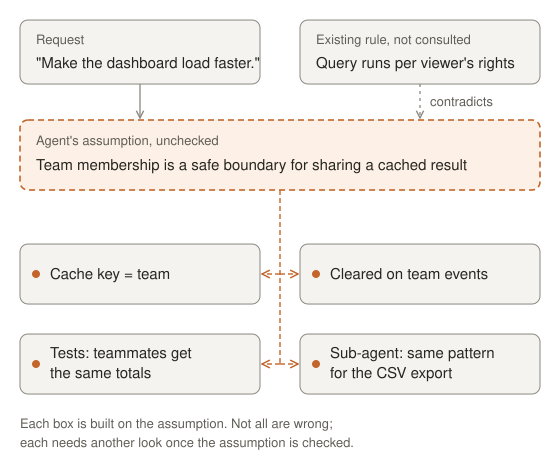
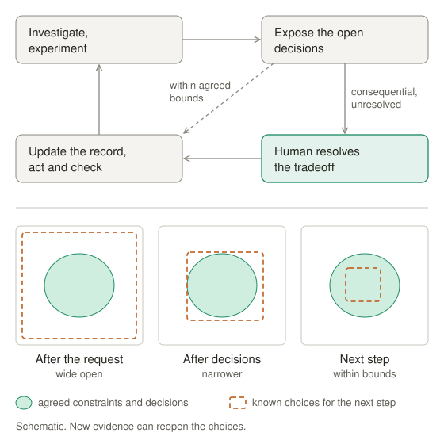
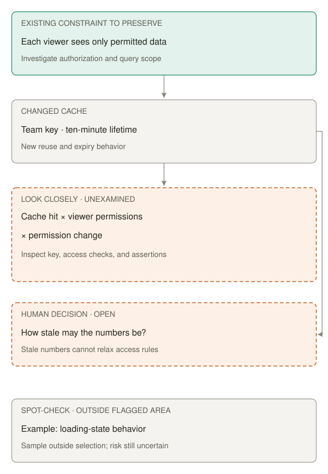

# Agentic agility

*Agents can build faster than we can understand. Keep commitments small where the assumptions are unresolved.*

"Make the dashboard load faster."

That is the whole request. An agent finds the slow aggregate query and caches its result per team for ten minutes. The tests pass, the page is quick, and nothing in the request was ignored. *(This is an illustration, not a real incident.)*

Two decisions came with that cache, and nobody made either of them on purpose.

The first had already been made. The old query ran once per viewer, with that viewer's permissions: a manager saw the salary column, an engineer on the same team did not. Sharing one result per team assumes that team membership is a safe boundary for sharing. The code said otherwise, and the agent did not look.

The second had never been made. The numbers used to be live. Now they can be ten minutes old, even right after someone's access changes. Whether that is acceptable is a product question, and nobody asked it.

One is a constraint the agent should have found, the other a question it should have asked. Both get expensive the same way: through everything built on them before anyone looks.

## Writing the spec is not agreeing on it

One popular reading of spec-driven development goes like this: write a large specification, let the agent implement it in one go, then find out how much agreement the document actually held. We have been here before, with the big requirements documents of the past. Agents can now write and maintain the document for me. They cannot read it for me.

That criticism needs a precise target. Spec-driven development also includes workflows with feedback and small tasks; [GitHub's introduction to Spec Kit](https://github.blog/ai-and-ml/generative-ai/spec-driven-development-with-ai-get-started-with-a-new-open-source-toolkit/) builds in checkpoints for reflection and refinement. A specification is a fine place to keep decisions reached that way. The trouble starts when approving the whole document becomes the way we agree. In her [evaluation of Kiro, Spec Kit and Tessl](https://martinfowler.com/articles/exploring-gen-ai/sdd-3-tools.html), Birgitta Böckeler found verbose, repetitive documents, heavy review overhead, and elaborate instructions that gave a false sense of control.

Agents can now produce more than I can judge. My judgment is the scarce part.

The dashboard request was short. A long specification could have hidden the same assumption about sharing, or slipped in the same ten-minute lifetime, and keeping it up to date would not have told me whether I had looked at either.

| What I hand over | What I still need to judge |
| --- | --- |
| A detailed specification | Which choices in it have I actually settled? |
| A short request | Which constraints must the agent find, and which choices are still open? |

The size of the document says little about the size of the commitment. A long reference can hold many decisions already reviewed. A short instruction can launch a lot of work on an open question. The expensive mistake is letting that work pile up before anyone examines the question.

## A wrong assumption gathers dependents

An open question gets expensive when the agent commits to an answer without checking it. Investigating, running a throwaway experiment or keeping the existing rule would all have counted as progress. Here the agent committed: the team is the sharing boundary. That premise then gathers dependents. The cache key is the team. The cache is cleared when the team's data changes. The tests check that two teammates get the same cached totals. A sub-agent asked to "speed up the CSV export the same way" copies the pattern. Each step is consistent with the premise, and each depends on it.

When someone finally checks the premise against the permission rules, all four need another look. Not all of them will be wrong; the invalidation logic may survive. But each was built on the premise, and the more work rests on it, the more there is to check.

Delegation can widen the circle in two ways. A handoff can lose a decision: Cognition's [case against multi-agent setups](https://cognition.com/blog/dont-build-multi-agents) is that every action carries implicit decisions a sub-agent working from partial context cannot see, and a study of more than 1,600 multi-agent traces lists misalignment between agents as one of its three main failure classes ([Cemri et al.](https://arxiv.org/abs/2503.13657)). Or the handoff passes the premise on faithfully, wrong as it was. This is no argument against delegation; on work that splits into independent parts, more agents can help ([Kim et al.](https://arxiv.org/abs/2512.08296)). The trouble is an unchecked premise that many parts share. Tests written from that premise pass. A test written from the permission rules would have failed.

## Count all of my attention

My first definition of *agentic leverage* was a token ratio: the output tokens of the deliverable divided by the input tokens I wrote to get it. Output meant the deliverable only, not the agent's reasoning, its tool calls or the instructions it passed to other agents.

That ratio captures the appeal: a little from me, a lot from the agent. But it rewards verbosity. Deleting unnecessary code can be valuable and produce almost no output. A short prompt can leave me with hours of reading and correcting.

I keep the ratio under a different name, *token leverage*, as a measure of amplification. What I actually want to increase is something else.

**Agentic leverage is the useful, accepted work I get per unit of my attention: explaining, answering, reading, reviewing and correcting.**

| Token leverage counts | My attention also includes |
| --- | --- |
| The instructions I write | Explaining context and answering questions |
| The tokens delivered | Reading plans, checking evidence, judging results |
| Output relative to input | Correcting mistakes and revisiting dependent work |

This is a way to compare workflows, not a productivity score. Quality, compute cost and risk still sit beside it.

It has to be counted, because the feeling of speed is unreliable. In [METR's early-2025 trial](https://metr.org/blog/2025-07-10-early-2025-ai-experienced-os-dev-study/), experienced developers took 19% longer with AI, yet believed it had made them 20% faster. The tools have changed since, and METR's [2026 follow-up](https://metr.org/blog/2026-02-24-uplift-update/) explains why later measurements are harder. The gap between felt and measured speed is the point.

For the dashboard, checking the permission rules and asking how stale the numbers may be costs attention. The comparison that matters is that cost against the work it saves later.

## Make the next decision visible

The alternative to a big plan is not no plan. It is a loop that brings decisions to the surface a few at a time.

I start with enough direction for the agent to investigate: why something needs to happen, what should happen or how, whichever I know. The agent reads the code, runs a quick experiment if one is cheap, and comes back without a plan. It brings what it found, and the few decisions that would change the work. For the dashboard, with invented findings:

> **Found:** the query applies each viewer's permissions. Any speed-up keeps that rule; it is not up for decision.
> **Decision:** how fresh must the numbers be, and is a cache worth its complexity?
> **Why it matters:** the numbers are live today. A cache trades freshness for speed, including just after someone's access changes.
> **Options:** (a) cache per viewer, with a short lifetime; (b) share a result between viewers whose permitted data is identical, and recheck access on every hit; (c) no cache: the slow part looks like one join, which may be fixable.
> **Recommendation:** try (c) as a throwaway experiment and measure. Choose between (a) and (b) only if (c) falls short.
> **Unblocks:** the experiment now, the cache design later.

I answer: at most a minute old, permission changes show at once, try (c) first. Answering may take some reading. But I am answering the premise the work will rest on, not approving a document in which that premise is one line among hundreds. When the question is whether we agree on intent, the unit of review is a decision, not a document, even when the decisions live in one.

The answers go into a short record of what is agreed, what is assumed and what is still open. The record exists because long conversations drift: models tend to hold on to early assumptions after the conversation has moved past them ([Laban et al.](https://arxiv.org/abs/2505.06120)). So superseded decisions are struck out, and when the history starts to mislead, the next step starts fresh from the record. It is a guard I propose, not a proven one; a record can lose an assumption too.

When do I stop deciding and let the agent run? When the remaining choices fall within what we agreed, the important questions are answered or contained, and there is a credible way to check the result. Then the agent takes the next bounded step, and the questions reopen when any of that changes. The experiment with (c) is such a step: a big question is still open, but contained.

[IF THE USER AGREES] In my own project, every task brief an implementing agent receives carries the rule: "If THE TASK needs a decision that the specs do not make and that is costly to undo (a wire format, a public interface of another subsystem, a security boundary), do not guess: stop and say so."

None of this is new. [Boehm's spiral model](https://ieeexplore.ieee.org/document/59) resolved the riskiest unknowns first, and DORA counts [small batches](https://dora.dev/capabilities/working-in-small-batches/) among the capabilities that turn AI-assisted speed into better outcomes. Agents make it practical on ordinary tasks, because they do much of the investigating and prototyping.

## Review the change and what it touches

The same loop applies once there is something to inspect. Before the build, the evidence came from research and experiments. After it, the evidence is behavior, diffs and tests.

Suppose the loop was skipped and the cache from the opening arrives as a finished change. I do not want a summary that says permissions are respected. I want pointers I can check: the code, the assertion or observation, and why it addresses the risk.

Two questions need two kinds of evidence. Does a cache hit still respect the viewer's permissions, including after a manager moves to an engineering role? The existing rules answer what should happen; the evidence must show that it does. Older numbers never license showing data the viewer may no longer see. How stale may the numbers be? Nothing in the code answers that, so the agent should put it to me as a decision, then show that reuse and expiry follow my answer.

Risk comes from the existing system, the change and how they interact. The cache may be a small diff. The authorization path it affects may not have changed at all. Both belong in the review.

*Green marks an existing constraint; orange marks questions still to examine. Neither is a correctness score.*

A test that shows two requests return the same result may just encode the sharing assumption. A useful test runs as two viewers with different permissions and checks what each may see. I need to read what is asserted, and why.

Making risk visible helps: in a [controlled experiment](https://rebels.cs.uwaterloo.ca/papers/emse2024_yu.pdf), risk analytics improved reviewers' defect detection, though not their speed. That says nothing about how reliable an agent's ranking of risk is, so I check the agent's ranking against signals that do not share its blind spots, such as coverage of the changed lines, static analysis and the paths from changed code into unchanged code, and I look at a few places it did not flag. Those signals have limits of their own: coverage cannot tell me whether an assertion tests the right behavior.

Corrections go back as instructions: fix the implementation, strengthen a check, drop an assumption, or reopen a product decision. Changing the requirement just to fit the code would hide the disagreement.

All of this assumes I can judge what the agent shows me. Its map of the risks does not give me the mental model I need to question it.

## Keep enough understanding to challenge the next answer

Delegation can remove the very activity through which understanding forms. In a randomized experiment, 52 mostly junior developers learned an unfamiliar Python library with or without an AI assistant. On a quiz straight afterwards, the AI group averaged 50% against 67%, with the largest gap on debugging ([Shen and Tamkin](https://arxiv.org/abs/2601.20245)). Those in the AI group who asked for explanations did better than those who only asked for code, though that was observed, not randomized, and a short task is not years on a familiar system. The study supports the worry; it does not settle it.

Reading every line of every change would give away the leverage, though some changes deserve it. As a default, I aim for the part that lets me reason about the rest: the main structures and their contracts, who owns which state, where the trust boundaries are, how things fail, and the few details that carry weight, like a cache key that decides who sees what. Call it 20/80 if you like; it is a rule of thumb, not a measurement. Consistent patterns and machine-checked contracts make reasoning about unread code less of a gamble. They do not make it safe, because consistency can also repeat a mistake everywhere.

One practice I want to make a habit is to predict before reading. Before opening the agent's explanation, write down what you expect. A manager moves to an engineering role; under the agreed rule permission changes show at once, so what does she see on her next refresh? Then check the prediction against the code or a test. If they disagree, one of them is wrong, and finding out which is the point: either my model of the system needs fixing, or the code breaks the rule we agreed.

Peter Naur argued in 1985 that a program's real design lives in the heads of the people who build it, as a theory of how the program meets the problem, which documentation only partly captures ([Programming as Theory Building](https://gwern.net/doc/cs/algorithm/1985-naur.pdf)). The loop gives me natural moments to keep that theory current, since every decision asks me to engage. But approving a recommendation without thinking is as easy as approving a document. The loop makes room for learning; the learning is still mine to do.

## Match the commitment to the task

How much back-and-forth a task needs depends on the task. A familiar change with good checks may need one pass: execute, then check. An uncertain idea may be ready for a small experiment and far from ready for a large implementation.

[Dex Horthy describes this proportional approach](https://github.com/humanlayer/advanced-context-engineering-for-coding-agents/blob/main/wsff.md) from his own practice: straightforward tasks get one shot or light feedback, larger work gets more design and review as it goes. That is one practitioner's experience, not a schedule for every team.

| When | A reasonable next step |
| --- | --- |
| The work is familiar and the checks are good | Execute and check |
| An important unknown is cheap to explore | Run a small experiment |
| An open choice is costly to undo | Settle it before building on it |
| The bounds are agreed and the result can be evaluated | Delegate a larger bounded step |

Long autonomous runs fit this too: [Anthropic describes](https://www.anthropic.com/research/harness-design-long-running-apps) agents that plan, build and evaluate for hours. How long a run takes says little about how much it commits to unchecked. Likewise, a long specification can be the right home for stable interfaces and for decisions reached one at a time. Better models will investigate and check better. They still cannot recover a preference nobody has stated.

I cannot prove this beats other ways of working; it is a proposal built on the evidence above.

Back to the dashboard. Two questions, one about who may share a result and one about how stale the numbers may be, could have been settled before anything was built on them. That is the leverage I am after: more useful work from my attention, and enough understanding left to steer the next change.

Before the next commitment, ask: which assumptions does it rest on, and what evidence would make them safe to accept?
